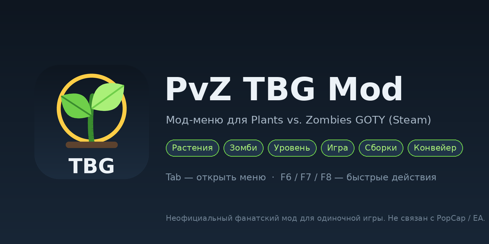
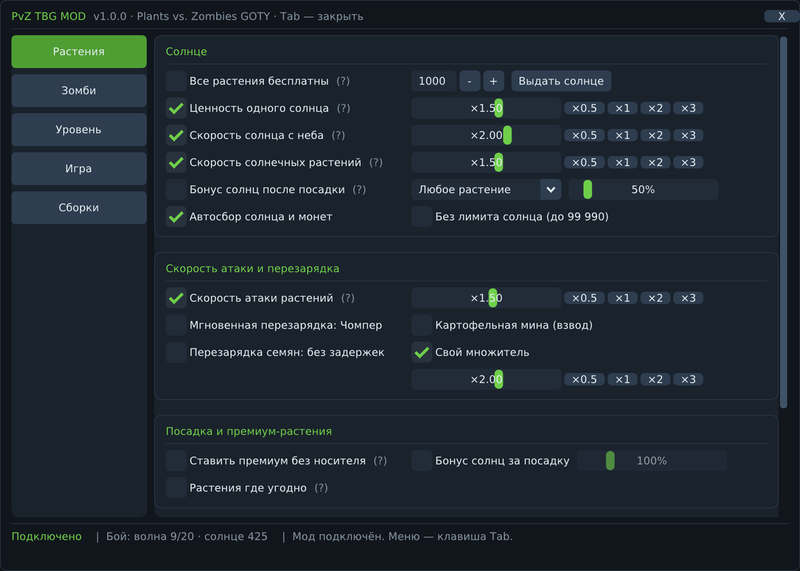
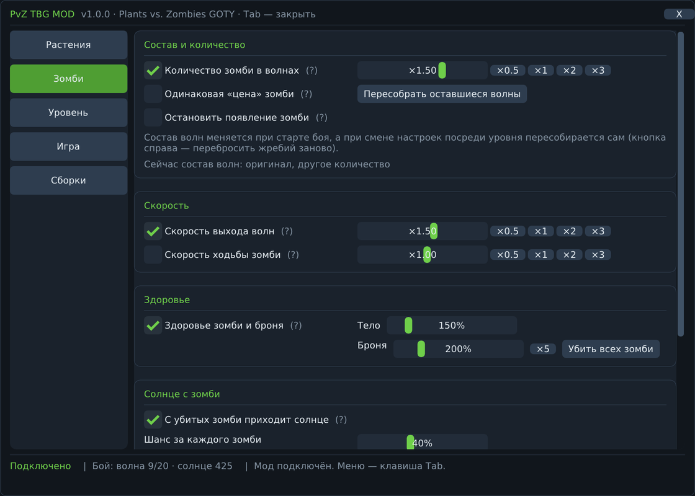
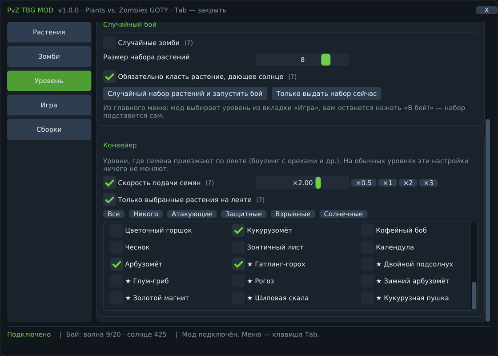
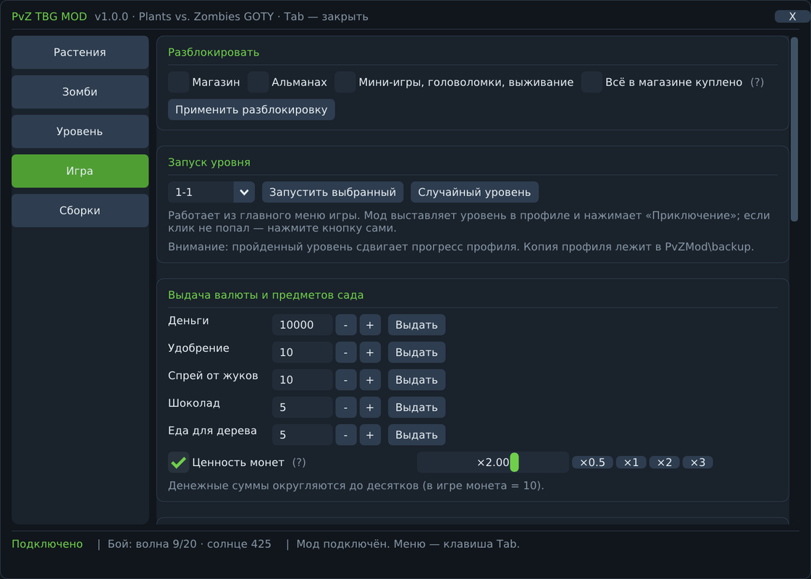
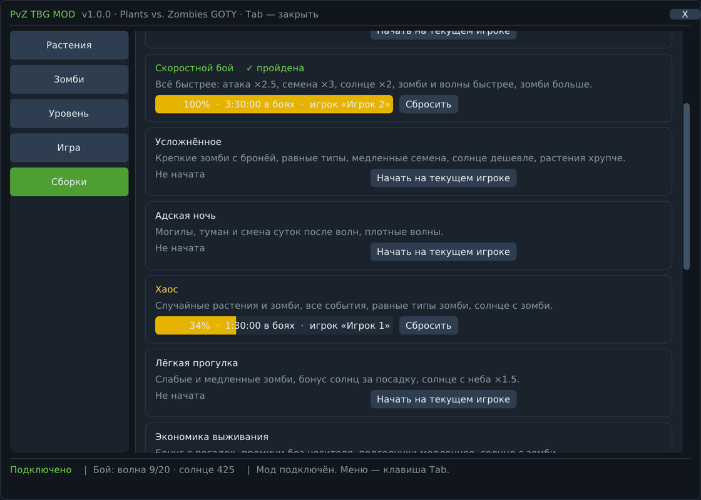
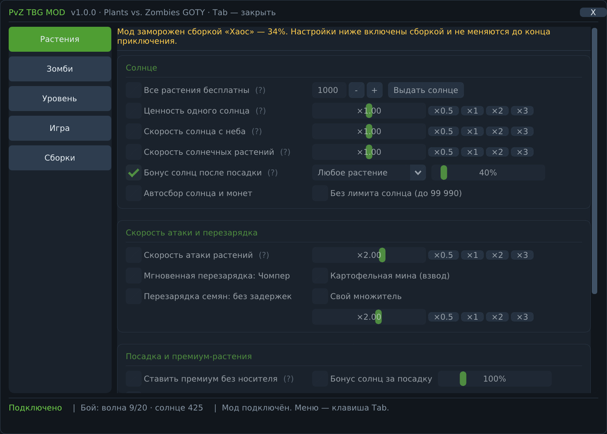

<p align="center">
  
</p>

<p align="center">
  <a href="https://github.com/fantweek/pvz-tbg-mod/actions/workflows/ci.yml"></a>
  
  
  
</p>

<p align="center"><b>Русский</b> · <a href="README.en.md">English</a></p>

# PvZ TBG Mod

Мод-меню для **Plants vs. Zombies GOTY Edition (Steam, версия 1.2.0.1096, английская)**. Нажмите **Tab** в игре — откроется окно с настройками:
растения, зомби, уровень, игра, готовые сборки. Только для одиночной игры.

> Неофициальный фанатский проект. Не связан с PopCap / Electronic Arts. Файлов игры в репозитории нет — нужна ваша собственная копия.

## Возможности

| Вкладка | Что есть |
|---|---|
| **Растения** | бесплатные растения, выдача солнца, **ценность солнца**, **скорость солнца с неба** и солнечных растений (в обе стороны), бонус солнц за посадку, автосбор, скорость атаки, перезарядка семян, премиум без носителя, «где угодно», здоровье и неуязвимость |
| **Зомби** | количество и состав волн, скорость волн и ходьбы, здоровье тела и брони, **солнце с зомби**, стоимость зомби в «Я, зомби» |
| **Уровень** | случайные события, случайные растения / зомби / набор, **конвейер** (скорость подачи, свой набор растений) |
| **Игра** | разблокировки, запуск уровней, деньги и предметы сада, **выдача растений**, **достижения**, ценность монет, скорость игры |
| **Сборки** | 11 готовых сборок с **процентом прохождения** и **заморозкой** остальных функций, свои конфигурации |

Горячие клавиши: **Tab** — меню, **F6** — выдать солнце, **F7** — убить всех зомби, **F8** — скорость ×2.

Подробно: [docs/FEATURES.ru.md](docs/FEATURES.ru.md).

## Скриншоты

<p align="center">
  
  
  
  
  
  
</p>

<sub>Снимки созданы кодом меню из репозитория на Linux (`python tools/screenshots/make_screenshots.py`): окно и настройки те же, но шрифт DejaVu Sans; в игре меню использует Segoe UI. Значения в полях — демонстрационные.</sub>

## Установка (кратко)

1. Скачайте архив из [Releases](https://github.com/fantweek/pvz-tbg-mod/releases) и распакуйте `pvzmod.dll` и `PvZModLauncher.exe` в папку игры (рядом с `PlantsVsZombies.exe`).
2. В Steam → игра → Свойства → Параметры запуска вставьте `"C:\путь\к\PvZModLauncher.exe" %command%`.
3. Запустите игру кнопкой «Играть» и нажмите **Tab**.

Полная инструкция, автозапуск и решение проблем: [docs/INSTALL.ru.md](docs/INSTALL.ru.md).

## Состояние проекта

Бета. Мод проверяется только на одной сборке игры (Steam 1.2.0.1096): на других версиях он сам отключается (метка в exe не совпадёт),
а перед записью в код игры сверяет байты и отказывается от патча при несовпадении.
Логика мода покрыта тестами на подделанной памяти игры (`python scripts/build.py test`), но не всё проверено на настоящей игре —
см. [раздел «Что проверено»](docs/FEATURES.ru.md#что-проверено-а-что-нет). Нашли ошибку — заведите [issue](https://github.com/fantweek/pvz-tbg-mod/issues).

Не сделано: **расширенный экран 16:10**. Нужны адреса геометрии поля для 1.2.0.1096 — помощь приветствуется ([docs/ARCHITECTURE.md](docs/ARCHITECTURE.md)).

## Сборка из исходников

Нужны Python 3 и ziglang (кросс-компилятор): MSVC не требуется.

```bash
pip install ziglang pillow     # pillow нужен только для пересоздания иконки
python scripts/build.py all    # тесты + сборка + архив в dist/
```

Результат: `build/pvzmod.dll`, `build/PvZModLauncher.exe`, `dist/PvZ-TBG-Mod-<версия>.zip`. Устройство проекта: [docs/ARCHITECTURE.md](docs/ARCHITECTURE.md).

## Безопасность и антивирусы

Лаунчер подключает DLL к процессу игры (`CreateRemoteThread` + `LoadLibrary`) — так работают все такие моды, поэтому антивирус может ругнуться.
Исходники открыты, сборка воспроизводима. Не используйте мод с онлайн-режимами: он рассчитан на одиночную игру.

## Лицензия

[MIT](LICENSE). Сторонние компоненты: [THIRD_PARTY_NOTICES.md](THIRD_PARTY_NOTICES.md) (Dear ImGui — MIT).
