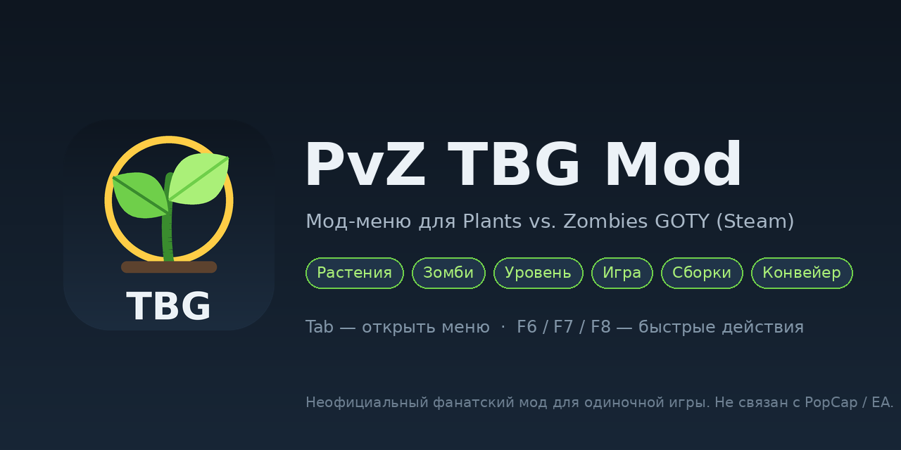
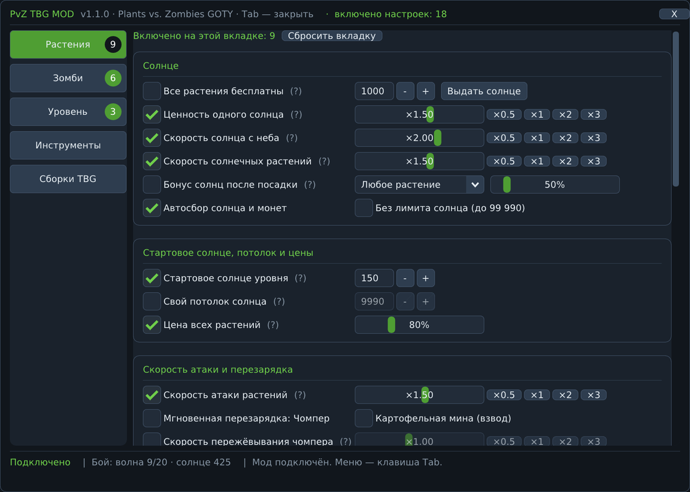
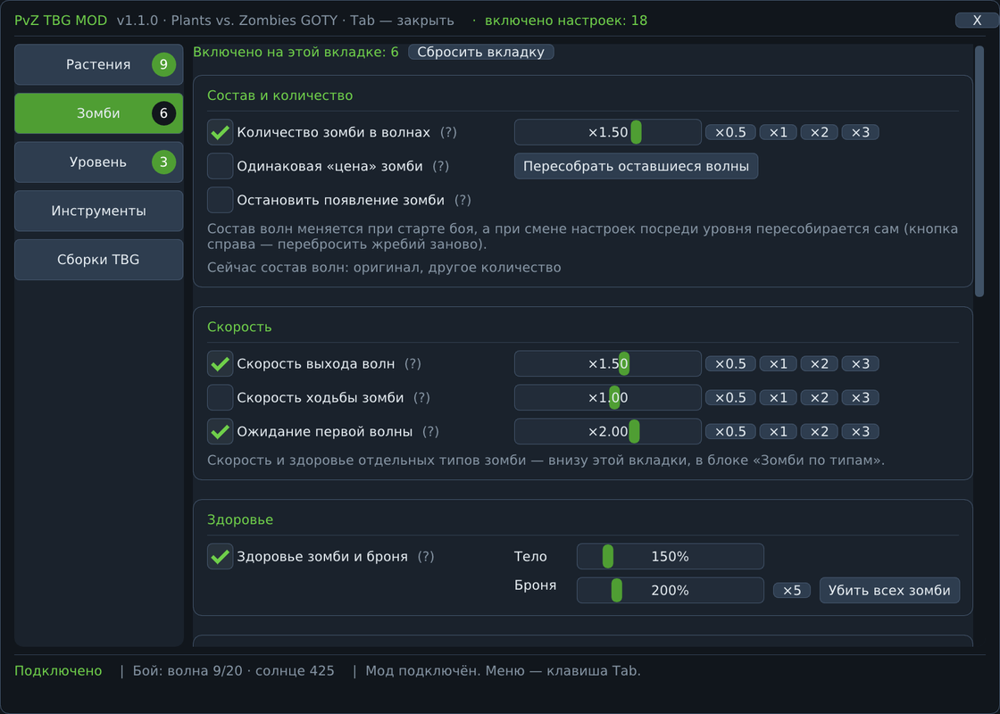
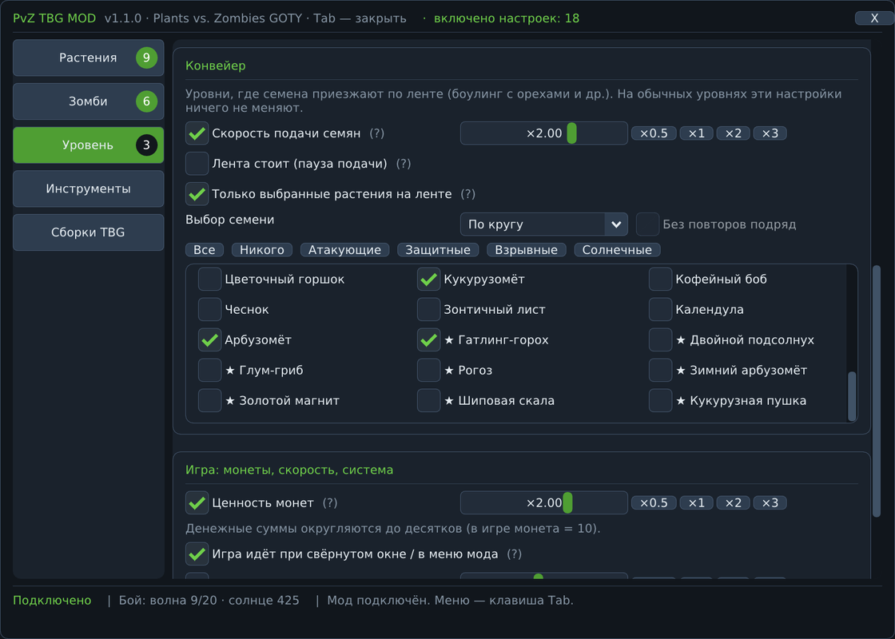
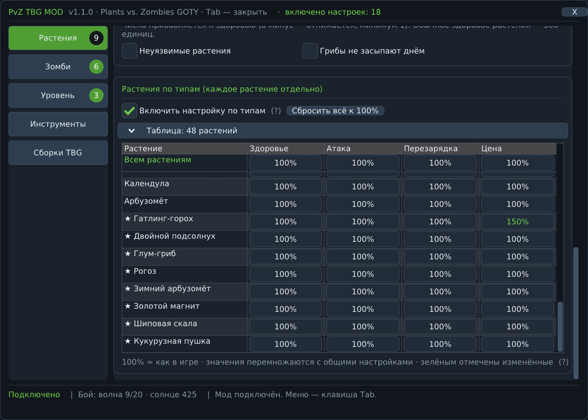
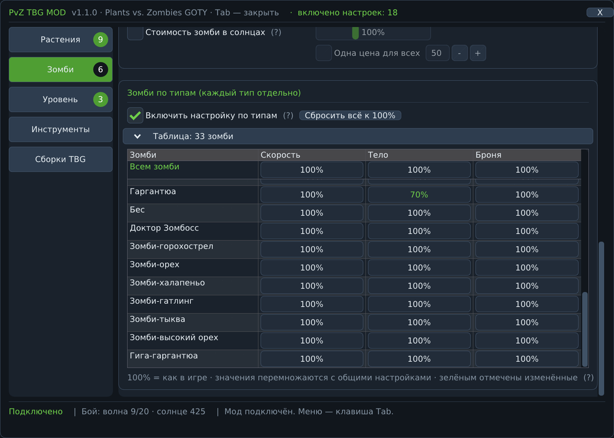
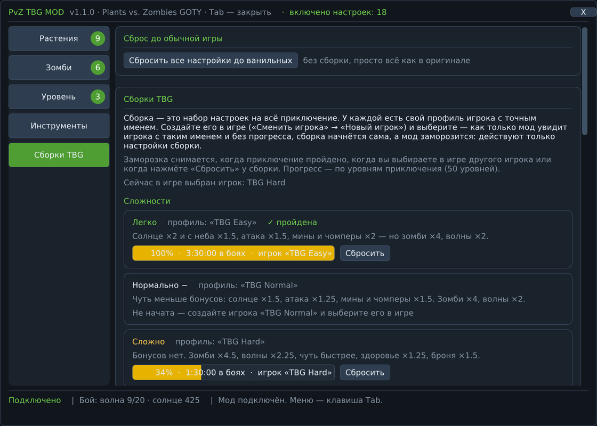
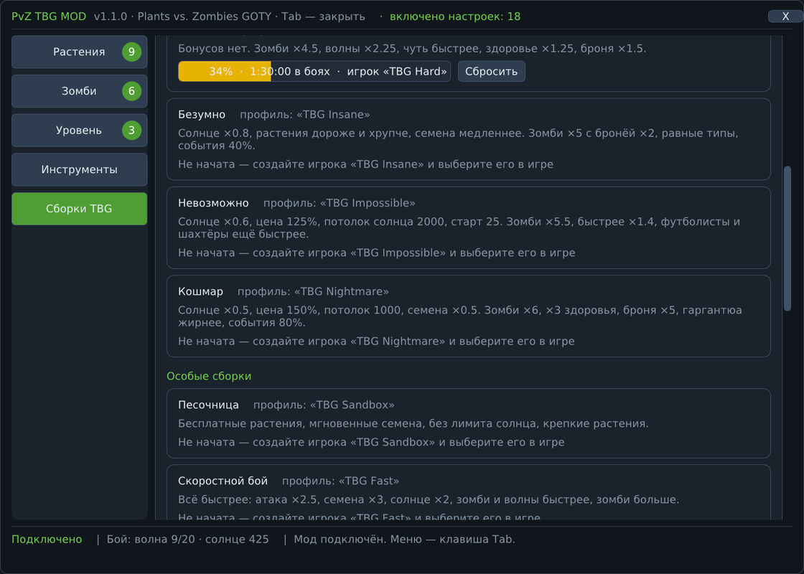
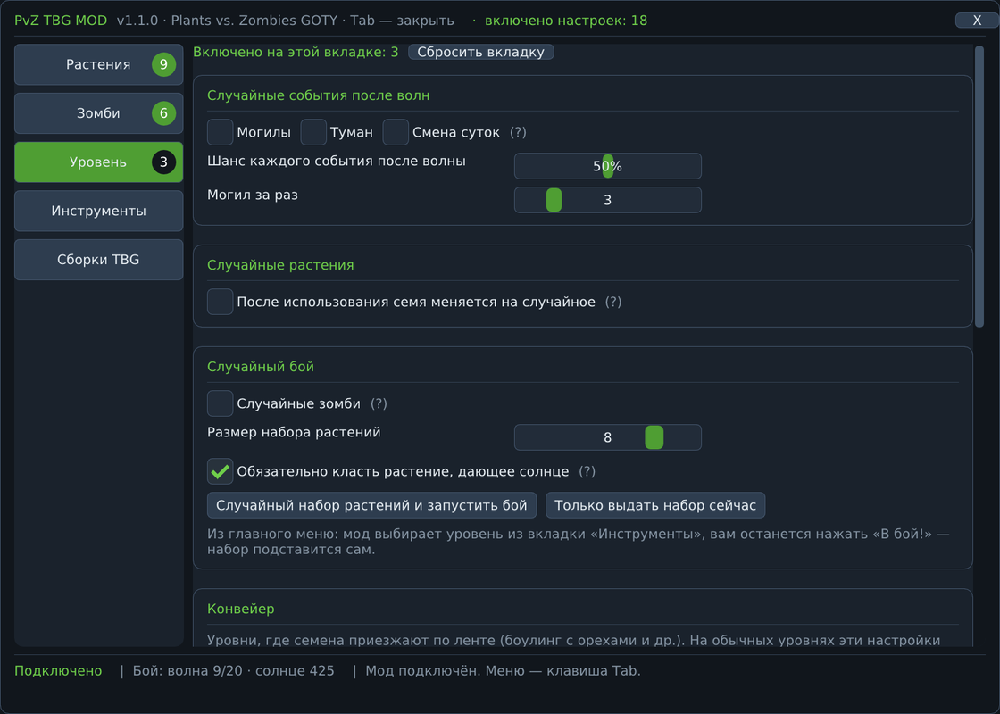
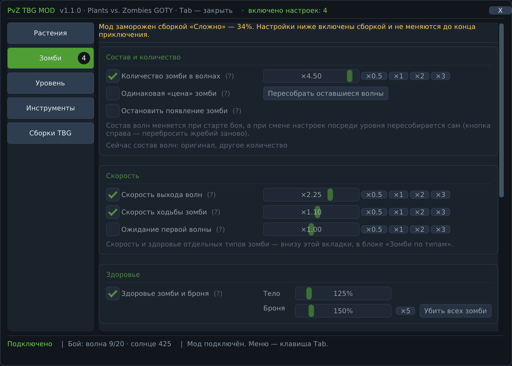

<p align="center">
  
</p>

<p align="center">
  
</p>

<p align="center"><a href="README.md">Русский</a> · <b>English</b></p>

# PvZ TBG Mod

An in-game mod menu for **Plants vs. Zombies GOTY Edition (Steam, version 1.2.0.1096, English)**. Press **Tab** in game to open it.
Single-player only. The interface is in Russian.

> Unofficial fan project, not affiliated with PopCap / Electronic Arts. The repository contains no game files; you need your own copy of the game.

## Features

- **Plants:** free plants, sun giveaway, sun value multiplier, sky-sun and sun-plant speed (faster or slower), **start sun, sun cap, plant price**, planting bonus, auto-collect, attack speed, seed recharge, premium plants without the base plant, plant anywhere, health / invincibility.
- **Zombies:** wave size and composition, wave and walking speed, body/armour health, **sun drops from zombies**, first-wave delay, zombie cost in "I, Zombie".
- **Level:** random events, random plants / zombies / seed set, **conveyor belt** (feed speed, pause, custom plant pool, random / round-robin pick).
- **Per type** (bottom of the Plants and Zombies tabs): per-plant (48) health, attack speed, seed recharge and price; per-zombie (33) speed, body and armour health. All in percent, both directions (easier or harder).
- **Tools:** unlocks, level launcher, money and Zen Garden items, plant and achievement grants. Coin value and game speed live on the Level tab.
- **Overview:** every settings tab shows how many settings are on, the header shows the total, and "Reset tab" restores just that tab.
- **TBG builds:** a vanilla-reset button, a six-step difficulty ladder (Easy, Normal−, Hard, Insane, Impossible, Nightmare) and nine special builds. Each build has its own in-game player name (`TBG Hard`, `TBG Easy`, …): create and select that player, progress tracking starts by itself and the mod **freezes** until the adventure is finished, you select another player, or you reset it. Saved configurations.

Hotkeys: **Tab** menu, **F6** give sun, **F7** kill all zombies, **F8** speed ×2.

## Screenshots

<p align="center">
  
  
  
  
  
  
  
  
  
</p>

<sub>Rendered by the repository's own menu code on Linux (`python tools/screenshots/make_screenshots.py`) with DejaVu Sans; in game the menu uses Segoe UI. Values are sample data.</sub>

## Install

1. Download [download/PvZ-TBG-Mod-1.1.0.zip](download/PvZ-TBG-Mod-1.1.0.zip) (use the **Download raw file** button on the file page), unzip it and put `pvzmod.dll` and `PvZModLauncher.exe` next to `PlantsVsZombies.exe`.
2. In Steam → game → Properties → Launch options: `"C:\path\to\PvZModLauncher.exe" %command%`.
3. Start the game and press **Tab**.

More: [docs/INSTALL.en.md](docs/INSTALL.en.md).

## Status

Beta. The mod only enables itself on Steam build 1.2.0.1096 (it checks the exe timestamp) and verifies code bytes before patching.
Logic is unit-tested against simulated game memory (`python scripts/build.py test`), but not everything has been verified on a real game.
Not implemented: 16:10 widescreen (needs layout addresses for this build).

## Build

```bash
pip install ziglang pillow
python scripts/build.py all
```

Cross-compiles 32-bit Windows binaries with zig; no MSVC needed. See [docs/ARCHITECTURE.md](docs/ARCHITECTURE.md).

## License

[MIT](LICENSE); third-party: [THIRD_PARTY_NOTICES.md](THIRD_PARTY_NOTICES.md).
