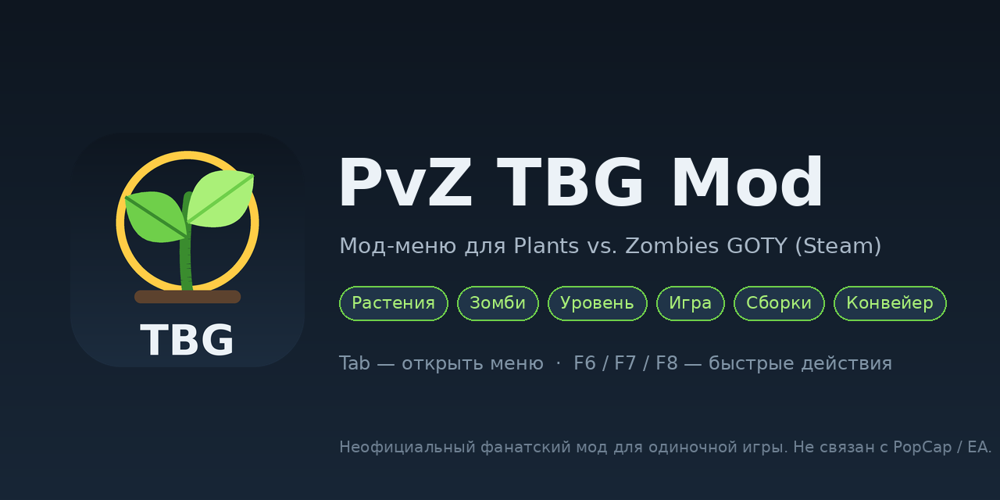
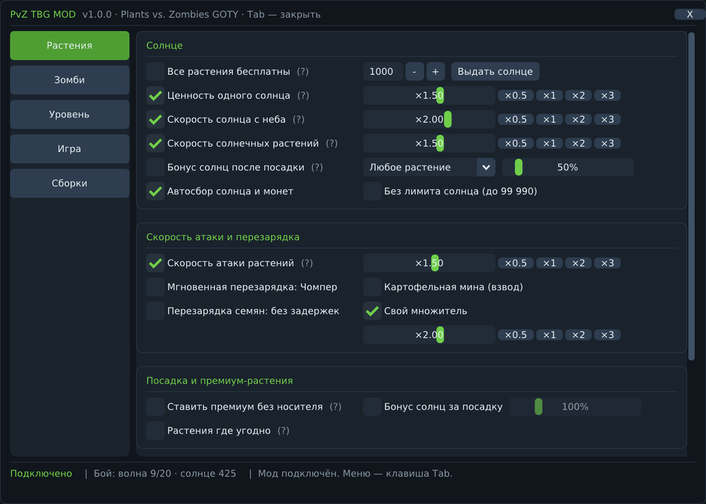
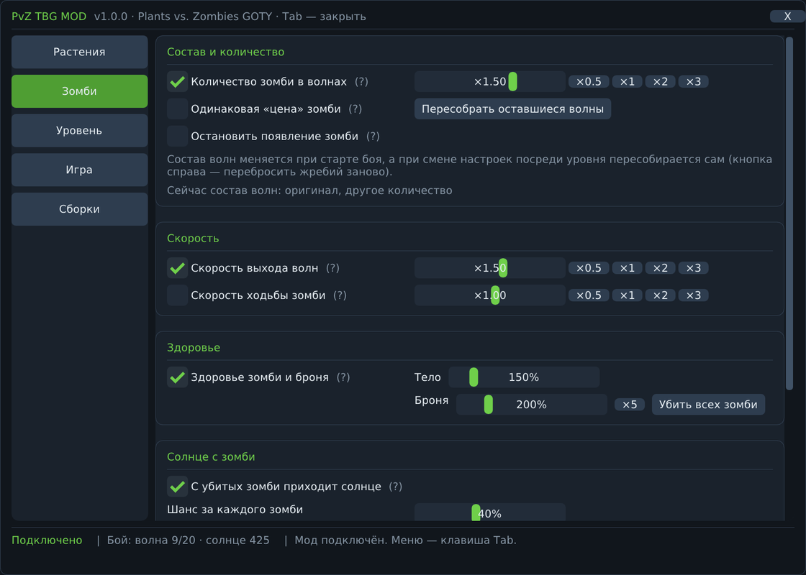
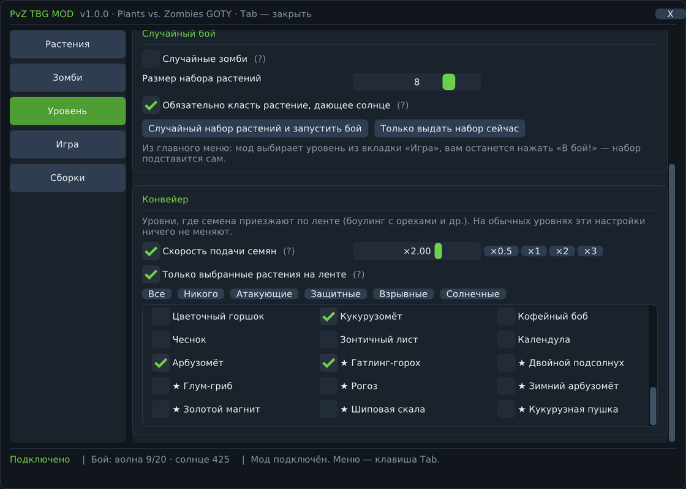
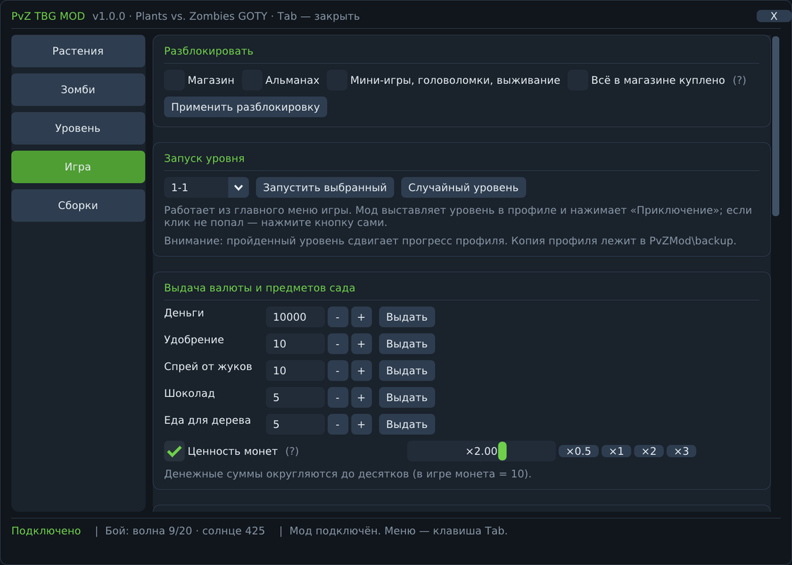
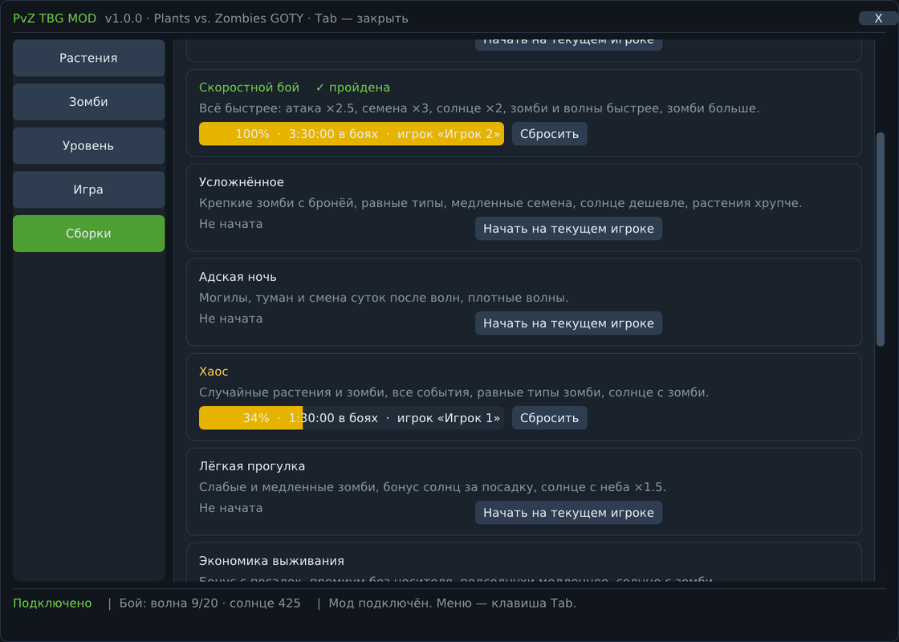
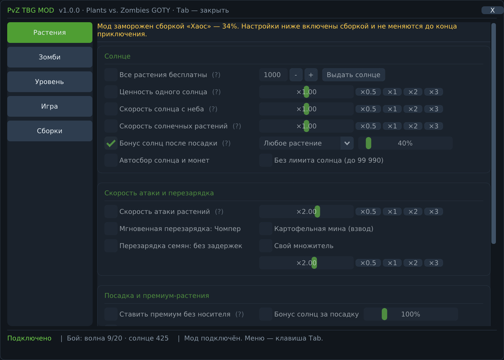

<p align="center">
  
</p>

<p align="center">
  
  
  <a href="PvZ-TBG-Mod-1.0.0/PvZ-TBG-Mod/source/LICENSE"></a>
</p>

<p align="center"><b>Русский</b> · <a href="PvZ-TBG-Mod-1.0.0/PvZ-TBG-Mod/source/README.en.md">English</a></p>

<h1 align="center">PvZ TBG Mod</h1>

**Мод-меню для Plants vs. Zombies GOTY Edition (Steam).** Нажмите **Tab** прямо в игре — откроется окно, где можно подкрутить солнце, растения, зомби и волны,
включить конвейер, выдать растения и достижения или пройти приключение по одной из готовых сборок с процентом прохождения.

> Неофициальный фанатский проект для **одиночной игры**. Не связан с PopCap / Electronic Arts. Файлов игры в репозитории нет — нужна ваша собственная копия.

**Содержание:** [Возможности](#возможности) · [Скриншоты](#скриншоты) · [Установка](#установка) · [Первые шаги](#первые-шаги) · [Вопросы и ответы](#вопросы-и-ответы) · [Состояние проекта](#состояние-проекта) · [Сборка](#сборка-из-исходников) · [Структура](#структура-репозитория) · [Лицензия](#лицензия)

## Возможности

| Вкладка | Что есть |
|---|---|
| **Растения** | бесплатные растения · выдача солнца · **ценность одного солнца** · **скорость солнца с неба** и солнечных растений (быстрее и медленнее) · бонус солнц за посадку · автосбор · скорость атаки · перезарядка семян · премиум-растения без носителя · «растения где угодно» · здоровье и неуязвимость |
| **Зомби** | количество и состав волн · скорость волн и ходьбы · здоровье тела и брони · **солнце с зомби** · остановка появления · стоимость зомби в режиме «Я, зомби» |
| **Уровень** | случайные события после волн · случайные растения, зомби и набор · **конвейер**: скорость подачи семян и свой набор растений на ленте |
| **Игра** | разблокировки · запуск уровней · деньги и предметы сада · **выдача растений** (в слоты боя или навсегда) · **достижения** · ценность монет · скорость игры |
| **Сборки** | **11 готовых сборок** с процентом прохождения и **заморозкой** остальных функций · свои конфигурации (сохранить / загрузить / удалить) |

Горячие клавиши: **Tab** — меню · **F6** — выдать солнце · **F7** — убить всех зомби · **F8** — скорость ×2.
Все настройки применяются сразу и запоминаются между запусками. Подробное описание каждой функции: [docs/FEATURES.ru.md](PvZ-TBG-Mod-1.0.0/PvZ-TBG-Mod/source/docs/FEATURES.ru.md).

### Готовые сборки

Сборка — это челлендж на всё приключение: она запускается на отдельном (новом) игроке игры, пока приключение не пройдено, действуют только настройки сборки,
а меню и команды выдачи заблокированы. Прогресс (в процентах и по времени) сохраняется.

Песочница · Скоростной бой · Усложнённое · Адская ночь · Хаос · Лёгкая прогулка · Экономика выживания · Скудное солнце · Зомби-апокалипсис · Танковый прорыв · Броня-шторм

## Скриншоты

<p align="center">
  
  
  
  
  
  
</p>

<sub>Снимки созданы кодом меню из этого репозитория на Linux (<code>python tools/screenshots/make_screenshots.py</code>): окно и расположение элементов те же, но шрифт DejaVu Sans, а в игре меню использует Segoe UI. Значения в полях — демонстрационные.</sub>

## Установка

Нужна **Steam-версия Plants vs. Zombies GOTY 1.2.0.1096 (английская)**. На другой версии мод сам не включится и ничего не сломает.

1. Скачайте файлы из папки [PvZ-TBG-Mod-1.0.0/PvZ-TBG-Mod](https://github.com/fantweek/pvz-tbg-mod/tree/main/PvZ-TBG-Mod-1.0.0/PvZ-TBG-Mod) и положите `pvzmod.dll` и `PvZModLauncher.exe` в папку игры, рядом с `PlantsVsZombies.exe`
   (Steam → игра → Управление → Просмотреть локальные файлы).
2. В Steam: правый клик по игре → Свойства → Общие → Параметры запуска:
   ```
   "C:\полный\путь\к\PvZModLauncher.exe" %command%
   ```
3. Запустите игру обычной кнопкой **«Играть»** и нажмите **Tab**.

Другие способы запуска (лаунчер в трее, автозапуск, ручное подключение), решение типичных проблем и удаление: [docs/INSTALL.ru.md](PvZ-TBG-Mod-1.0.0/PvZ-TBG-Mod/source/docs/INSTALL.ru.md).

## Первые шаги

1. Нажмите **Tab** — откроется меню. Слева вкладки, справа настройки, внизу строка состояния («Подключено», номер волны, солнце).
2. Включите галочку, например «Ценность одного солнца», и двигайте ползунок: **×2** — солнце ценнее в два раза, **×0.5** — вдвое дешевле. Кнопки ×0.5 / ×1 / ×2 / ×3 — быстрые значения.
3. Хотите готовый челлендж? Вкладка **«Сборки»**: в игре создайте нового игрока и нажмите «Начать» у нужной сборки.
4. Свои наборы настроек: **«Сборки» → «Мои конфигурации»**. Текущие настройки и так запоминаются сами (`PvZMod\last.ini`).
5. **Tab** закрывает меню, повторное нажатие открывает снова.

## Вопросы и ответы

<details>
<summary><b>Игра пишет «Unable to load Steam.dll»</b></summary>

Это ошибка самой игры при втором экземпляре или запуске вне Steam. Закройте все `PlantsVsZombies.exe` и `PvZModLauncher.exe` (Диспетчер задач, значок в трее),
запустите игру кнопкой «Играть» и не запускайте Steam и лаунчер с разными правами (оба обычным пользователем). См. [docs/INSTALL.ru.md](PvZ-TBG-Mod-1.0.0/PvZ-TBG-Mod/source/docs/INSTALL.ru.md).
</details>

<details>
<summary><b>Меню не видно поверх игры</b></summary>

Переключите игру в оконный режим: поверх полноэкранного эксклюзивного режима окна иногда не отображаются.
</details>

<details>
<summary><b>Можно ли с этим играть онлайн или получать достижения Steam?</b></summary>

Нет. Мод рассчитан только на одиночную игру. Достижения, которые он выдаёт, — это внутриигровой список профиля; достижения Steam он не затрагивает.
</details>

<details>
<summary><b>Не испортит ли мод мои сохранения?</b></summary>

Некоторые функции меняют данные профиля (деньги, разблокировки, открытые растения). При первом запуске мод копирует сохранения в `PvZMod\backup\userdata_first_run`;
для важного прогресса сделайте собственную копию папки `userdata` игры.
</details>

<details>
<summary><b>Антивирус ругается на лаунчер</b></summary>

Лаунчер подключает DLL к процессу игры (`CreateRemoteThread` + `LoadLibrary`) — так работают такие моды вообще, поэтому срабатывания возможны.
Исходники открыты, сборка воспроизводима: можно собрать самому ([см. ниже](#сборка-из-исходников)).
</details>

<details>
<summary><b>Как удалить мод?</b></summary>

Удалите `pvzmod.dll`, `PvZModLauncher.exe` и папку `PvZMod`, очистите параметры запуска в Steam, а при включённом автозапуске выполните `PvZModLauncher.exe --autostart off`.
</details>

## Состояние проекта

**Бета.** Мод рассчитан на одну сборку игры (Steam 1.2.0.1096): метка версии в exe проверяется при подключении, а перед записью в код игры мод сверяет байты и отказывается от патча при несовпадении.
Логика покрыта тестами на подделанной памяти игры (`python scripts/build.py test`), но не всё проверено на настоящей игре — подробности в разделе
[«Что проверено»](PvZ-TBG-Mod-1.0.0/PvZ-TBG-Mod/source/docs/FEATURES.ru.md#что-проверено-а-что-нет). Нашли ошибку — заведите [issue](https://github.com/fantweek/pvz-tbg-mod/issues) (шаблон подскажет, что указать).

**Планы / нужна помощь:** расширенный экран 16:10 — для него нужны проверенные адреса геометрии поля в 1.2.0.1096 ([docs/ARCHITECTURE.md](PvZ-TBG-Mod-1.0.0/PvZ-TBG-Mod/source/docs/ARCHITECTURE.md)); солнце с зомби «падающим шариком» вместо зачисления в банк.

История версий: [CHANGELOG.md](PvZ-TBG-Mod-1.0.0/PvZ-TBG-Mod/source/CHANGELOG.md).

## Сборка из исходников

Нужны Python 3 и ziglang (кросс-компилятор); MSVC и Visual Studio не требуются.

```bash
pip install ziglang pillow     # pillow нужен только для иконки и скриншотов
python scripts/build.py all    # тесты + сборка + архив в dist/
```

Результат: `build/pvzmod.dll`, `build/PvZModLauncher.exe`, `dist/PvZ-TBG-Mod-<версия>.zip`. Выпуск новой версии: изменить `src/version.h`, дополнить `CHANGELOG.md`, поставить тег `vX.Y.Z` — GitHub Actions соберёт и опубликует релиз.
Правила участия: [CONTRIBUTING.md](PvZ-TBG-Mod-1.0.0/PvZ-TBG-Mod/source/CONTRIBUTING.md).

## Структура репозитория

Готовые `pvzmod.dll` и `PvZModLauncher.exe` лежат в `PvZ-TBG-Mod-1.0.0/PvZ-TBG-Mod/`, исходники — в подпапке `source/`:

```
src/            исходный код мода и лаунчера (mod.cpp — ядро, ui.cpp — меню, cfg.h — настройки, launcher.cpp)
tests/          тесты логики на подделанной памяти игры
tools/          снимки меню для README
scripts/        build.py (сборка, тесты, архив), make_assets.py (иконка, баннер)
third_party/    Dear ImGui (MIT)
docs/           установка, описание функций, устройство проекта, скриншоты
assets/         иконка и баннер
```

## Лицензия

[MIT](PvZ-TBG-Mod-1.0.0/PvZ-TBG-Mod/source/LICENSE). Сторонние компоненты: [THIRD_PARTY_NOTICES.md](PvZ-TBG-Mod-1.0.0/PvZ-TBG-Mod/source/THIRD_PARTY_NOTICES.md) (Dear ImGui — MIT).
*Plants vs. Zombies* — торговая марка PopCap Games / Electronic Arts; проект с ними не связан.
